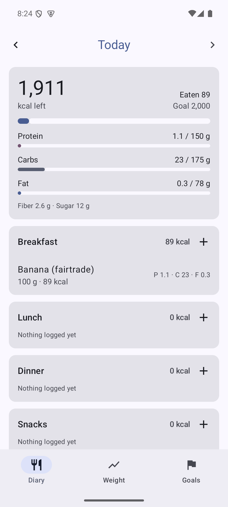
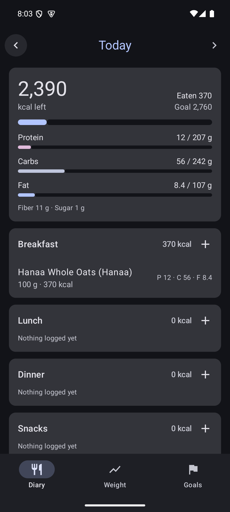

# Calore

A calorie and macro tracker for Android with **no ads, no tracking and no account**.

Log what you eat and Calore adds up calories, protein, carbs, fat, fiber and sugar for the day. Search millions of products from [Open Food Facts](https://world.openfoodfacts.org), or type in your own foods from the label.

<p>
  
  
</p>

## Features

- **Daily diary** grouped into breakfast, lunch, dinner and snacks, with a running total against your goals. Move between days or jump to any date.
- **About 300 basic foods** with Czech and English names (chicken breast, rice, tvaroh …), from USDA FoodData Central and typical Czech labels, available offline.
- **Food search** in Open Food Facts, with products sold in Czechia first, plus your own custom foods. Foods you use are kept on the phone, so they're there next time even offline.
- **Barcode scanner**: scan a product in the shop (or type the code); unknown products can be added in a moment.
- **Quick add**: log just the calories (and macros if you know them), for example for a meal out.
- **Recipes** in the Plan tab: 30 starter recipes (Czech home cooking and meal-prep classics) and your own, with calories and macros per serving, allergens, steps and storage times. Search, filter by meal or your diet; recipes with your allergens are hidden unless you ask. Scale a recipe for one cook or swap an ingredient and see the difference.
- **Log a dish**: "1.5 servings of my goulash", from Add food → Dishes or from the recipe itself.
- **Cook and fill prep boxes**: cook one or more recipes, follow cook mode with one timeline and timers, weigh the pot (the empty pot is subtracted) and fill boxes equally, by calories, by person, or mixed from several batches ("130 g chicken + 280 g rice"). Recipes learn how much they weigh cooked.
- **Kitchen tab**: boxes in the fridge and freezer with eat-by dates and colours, Ate it (logged with one tap, with undo), Ate part, Freeze, Thawed, Move and Throw away, plus a log of what was thrown away. Today shows the boxes to eat first.
- **People I cook for**: family members without the app, with their own targets, so their boxes get the right grams.
- **Freshness reminders** (optional): boxes to eat today in the morning, and what to thaw at 19:00.
- **Week plan** (Plan → Week): choose how often you cook; plan each meal for you and the people you cook for as a prep box, cook fresh, eat out or free; see each day's calories and protein against the targets and the week's cost; repeat last week or use a template. On a cooking day, **Cook** fills in the recipes and amounts and links each box to its meal.
- **Plan my week** (Plan → Week): one tap plans the whole week for you and the people you cook for: what to cook on each cooking day, how much, which box for which meal, and the shopping list. It follows your targets, diet, allergies, likes and dislikes, 👍 / 👎, budget, cooking days and what is at home. Lock or swap meals, regenerate the rest, then accept. Everything runs on the phone.
- **Use it up** (Kitchen → Pantry): food that goes off within 4 days, with recipes that use it.
- **Ratings**: 👍 / 👎 a recipe after eating it or on its page; the planner uses them.
- **Pantry** (Kitchen → Pantry): what you have at home with best-before dates; cooking takes ingredients out, oldest first.
- **Shopping list** (Shop tab): made from the plan minus what you have at home, in whole packs, grouped by shop; pick the exact product per shop, tick items into the pantry with the price paid, and share the list as text.
- **Stats** (Me → Stats): money spent and thrown away per month, and the cheapest protein you bought.
- **Portions in grams**, with one-tap serving sizes when the product has one. Tap a logged entry to change the amount or remove it (with undo).
- **Daily goals** for calories, protein, carbs and fat, with a short setup on the first start.
- **Calorie calculator**: Mifflin-St Jeor, or Katch-McArdle when you know your body fat; goals by speed (lose, maintain, gain or recomp) showing kg per week and kcal per day; automatic macros from protein per kg, or your own split.
- **Body**: weight history with a smoothed trend line, body fat from a tape measure (US Navy method, with a short how-to) or a number you know.
- **Weekly check-in**: after a few weeks of logging, Calore compares your weight trend with what you ate and suggests a new target in small steps.
- **Profile** under Me: body, goal, meal split, diet and allergies, cooking habits (used by the planner later).
- **Hide-numbers mode**: log food without seeing calories and macros.
- **Optional reminders** for the weekly check-in and for measuring body fat; a "Is the food in the fridge?" reminder 2 hours after cooking.
- **Backup to a file:** export everything (foods, diary, weights, profile, body, recipes, ratings, boxes, plans, pantry, shops and the shopping list), and import them on a new phone (Me → Settings → Backup).
- **English and Czech.** The app follows the phone's language; on Android 13 and newer you can also pick the app's language in Android's settings.
- Material You design with light and dark themes.

## Privacy

Everything you log is stored only in the app's private storage on your phone. There is no account, no analytics and no ad SDK. The only network requests the app makes go to Open Food Facts: a search sends the words you typed (and the app's country), a scan sends the barcode. The camera is used only to read barcodes on the phone; pictures are never saved or sent.

The app's data is included in Android's normal backup and phone-to-phone transfer, so it follows you to a new phone if you use those. A backup file you export yourself contains your health data, so keep it somewhere safe.

## Building

Requirements:

- JDK 17 or newer (Android Studio's bundled JDK works)
- Android SDK with platform 37 (Android 17)

Open the folder in Android Studio, or build from the command line:

```bash
./gradlew assembleDebug
```

The APK is written to `app/build/outputs/apk/debug/app-debug.apk`.

`./gradlew assembleRelease` produces a shrunk, unsigned release APK (about 2 MB) in `app/build/outputs/apk/release/`. Sign it with your own key before distributing.

The app runs on Android 8.0 (API 26) and newer.

Signed release APKs are built by GitHub Actions when a version tag is pushed; see [docs/RELEASING.md](docs/RELEASING.md).

On Windows, use `gradlew.bat` and make sure `JAVA_HOME` points at a JDK 17 install. If the SDK is not found, create `local.properties` with `sdk.dir=<path to your Android SDK>`.

### Tests

```bash
./gradlew testDebugUnitTest          # domain logic and Open Food Facts parsing (JVM)
./gradlew connectedDebugAndroidTest  # database and UI tests (needs a device or emulator)
./gradlew lintDebug
```

## Project layout

```
app/src/main/java/com/calore/tracker/
├── domain/      Pure Kotlin: nutrients, calorie calculator, validation. No Android imports.
├── data/
│   ├── db/      Room database (foods, diary entries, weights)
│   ├── prefs/   DataStore for goals and calculator inputs
│   ├── remote/  Open Food Facts client and parser
│   └── repository/
└── ui/          Jetpack Compose screens, one package per screen
```

Diary entries store a copy of the nutrients for the portion that was eaten. Editing or deleting a food later never changes past days.

## Contributing

Bug reports, translations and pull requests are welcome. See [CONTRIBUTING.md](CONTRIBUTING.md).

## License

Calore is free and open source software, released under the [BSD Zero Clause License (0BSD)](LICENSE). You may use, copy, modify, distribute and sell it for any purpose, with or without changes, without asking permission and without keeping any notice or attribution.

Food data © Open Food Facts contributors, available under the [Open Database License](https://opendatacommons.org/licenses/odbl/1-0/).
